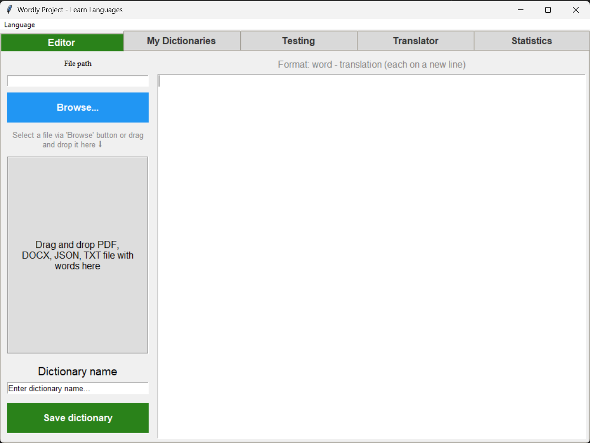
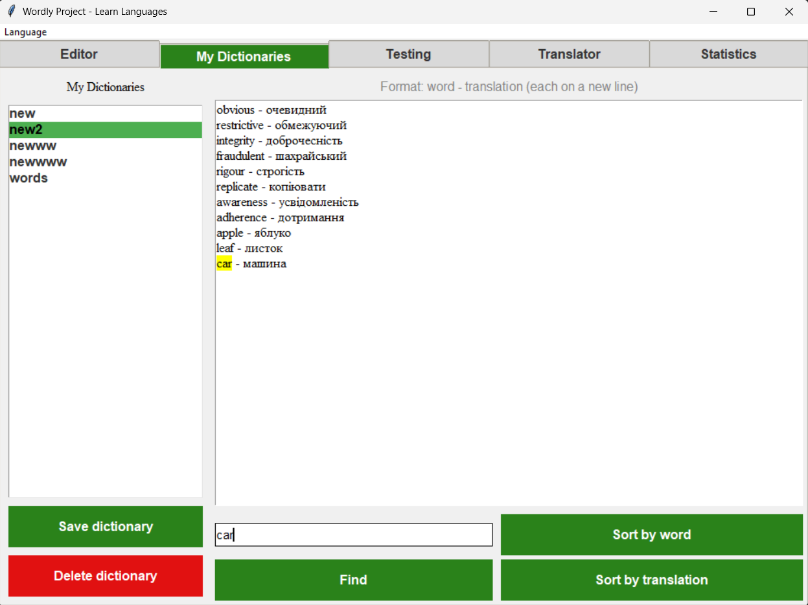
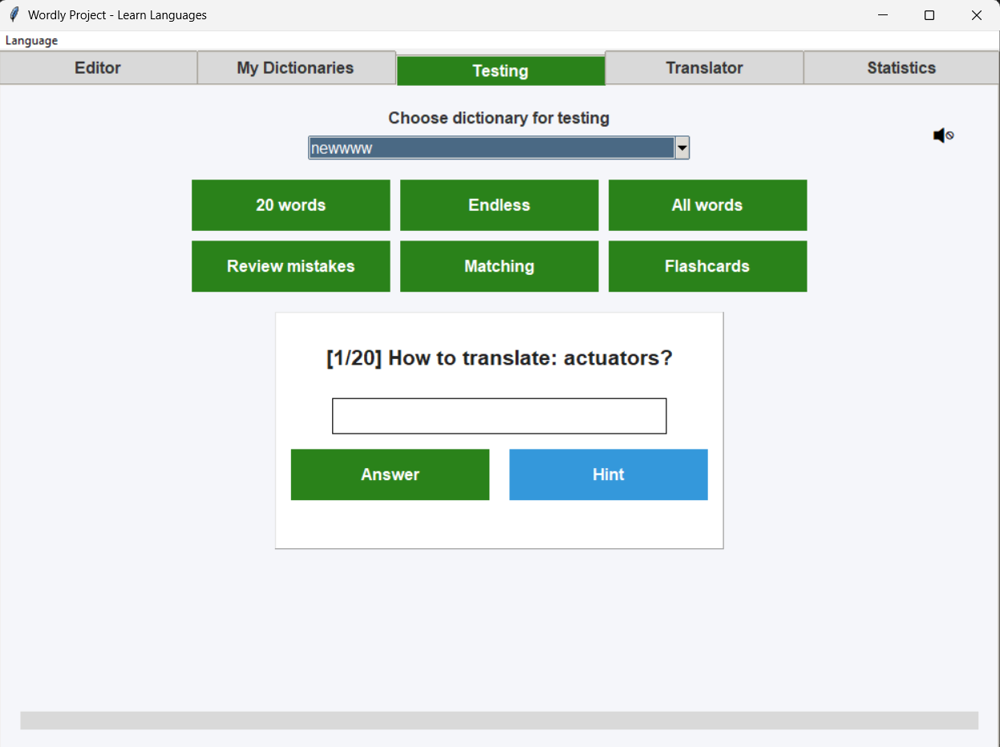
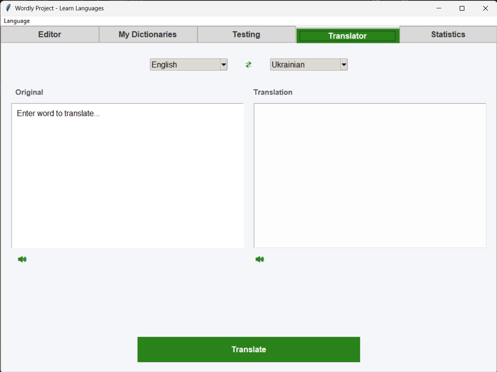
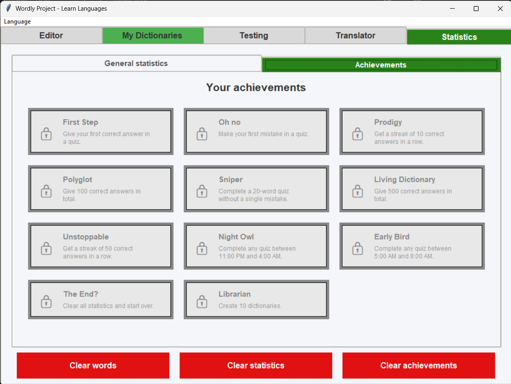

# 📘 Wordly

**Wordly** It is a desktop application for learning words—an updated version of Wordly—built using the MVC (Model–View–Controller) architecture..


---

## Features
- 🎯 Word testing
- 🔗 Matching exercise
- 🗂️ Learning cards 
- 🌐 Built-in translator 
- 🔁 Review incorrect answers
- 📊 Statistics and streaks
- 🏆 Achievements
- 🔊 Sound effects

---

## 🛠️ Tech Stack

- Python 3.13
- tkinter
- gtts (text-to-speech)
- MVC srtucture

## 🚀 Quick start


### Prerequisites
* Python 3.10+ installed

### Installation

1. **Clone the repository:**
   ```bash
   git clone https://github.com/Orestver/Wordly_MVC.git
   cd Wordly_MVC
   ```
2. **Create and activate a virtual environment:**
    - Windows:
        ```bash
        python -m venv venv
        venv\Scripts\activate
        ```
    - Linux / macOS:
        ```bash
        python3 -m venv venv
        source venv/bin/activate
        ```
3. **Install dependencies:**
    ```bash
    pip install -r requirements.txt
    

4. **Run the app:**
    ```bash
    python main.py
    ```

## 🎮 Usage

### 1. Dictionary creation
Start by creating or exporting your dictionary.

<p align="center">
  
</p>

### 2. Adding words to dictionary
Add the new words to your dictionaries or delete some.

<p align="center">
  
</p>

### 3. Testing and Quizes
Select your dictionary and quiz mode to start learning words.

<p align="center">
  
</p>


### 4. Translation
Your can check word translation inside the app in the google translator style.

<p align="center">
  
</p>

### 5. Stats & Achievements
Through quizzes and learning, you will earn achievements and see statistics from your tests.

<p align="center">
  
</p>

### and much more

Hope this was interesting for u:D